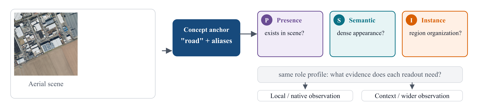
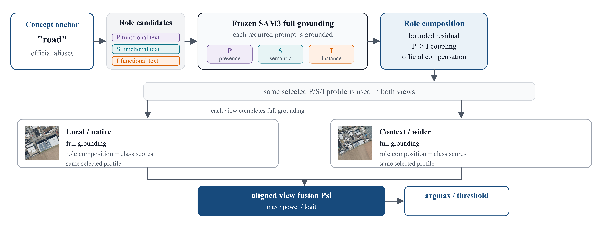
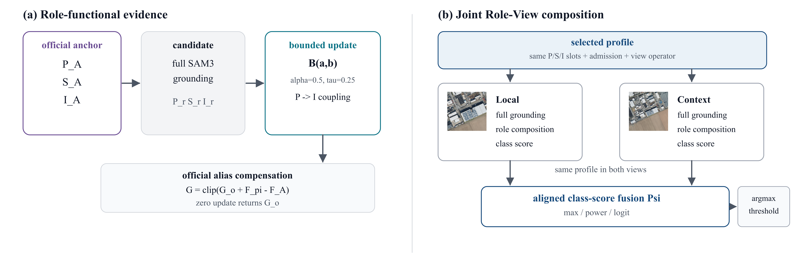
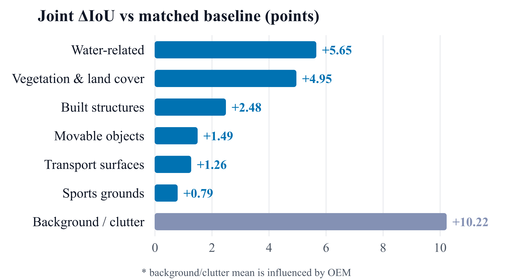
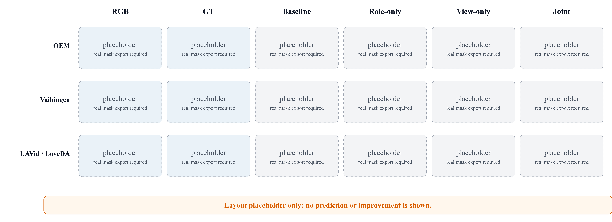

# 面向免训练遥感开放词汇语义分割的角色—视图联合专门化

*Abstract、Introduction、Related Work、Method、Experiments、Conclusion 的独立中文对照版。当前各主要章节已整理。暂用 Joint Role–View Specialization（JRV）作为方法名。引用编号与[参考文献](参考文献.md)一致。*

## 摘要

免训练遥感开放词汇语义分割要求在不更新分割模型的情况下，将任意文本类别落实到稠密遥感图像中。SAM3 与 SegEarth-OV3 提供了共享概念 grounding，并从中读取 Presence、Semantic 和 Instance 三类证据；现有方法通常用同一个类别级描述和同一个视觉观察约束全部 readout。本文研究共享概念 grounding 与异质证据需求之间的这一错配，提出角色—视图联合专门化（Joint Role–View Specialization，JRV）。JRV 保留官方类别 anchor，以完整冻结模型对角色功能候选进行 grounding，并通过有界 role-specific correction 更新证据，同时保留 Presence 与 Instance 的原生耦合。随后，方法在空间对齐的 Local 与 Context 观察上分别完成 grounding，复用同一角色配置，并在原始类别决策之前组合完整类别分数场。八个遥感基准上的实验将配对平均 mIoU 从 53.56 提升到 57.49，八个数据集均超过 baseline；固定 Role–View 配置的匹配因子分析在六个数据集上呈正交互。自然图像评价进一步显示角色补充的迁移性，同时表明视图组合依赖数据分布。结果说明，补充证据应按 readout 职责和观察条件组织，而不是把更多文本或更大视野默认视为普遍有益。我们的代码开源在：https://github.com/pengjunhao621-arch/SegEarth3。

Training-free open-vocabulary semantic segmentation must assign arbitrary textual categories to dense remote-sensing imagery without updating the segmentation model. Concept-grounded segmenters such as SAM3 and SegEarth-OV3 provide a shared grounding state with distinct Presence, Semantic, and Instance readouts, but current methods typically condition all readouts with one category-level description and one visual observation. We study the resulting mismatch between shared concept grounding and heterogeneous evidence requirements. We introduce Joint Role--View Specialization (JRV), which preserves the official class anchor, grounds role-functional candidates with the complete frozen model, and applies bounded role-specific corrections while retaining the native Presence--Instance coupling. JRV then grounds spatially aligned Local and Context observations, reuses the same role profile across both views, and composes their complete class-score fields before the original class decision. On eight remote-sensing benchmarks, JRV raises the matched average mIoU from 53.56 to 57.49 and improves every dataset over the baseline. A matched Role--View factorial analysis shows positive interaction on six of eight datasets, while the natural-image evaluations show transfer of role supplementation and the dataset dependence of view composition. These results support organizing supplementary evidence by readout responsibility and observation condition rather than treating additional text or larger visual fields as uniformly beneficial.

## 1. 引言

　　开放词汇语义分割（OVSS）要求在推理时为每个像素分配任意文本类别。免训练方法通常改造视觉—语言模型的稠密预测 [1,6]。SAM3 转而以文本概念约束一个共享 grounding 状态，并从中提供三种 readout：Presence 判断概念是否存在，Semantic 估计稠密覆盖，Instance 组织 query 生成的区域 [10]；SegEarth-OV3 将该接口用于遥感 [11]。共享状态稳定了类别语义，但三种 readout 对证据的需求并不相同。遥感场景中的小目标、连续地表和场景级存在性无法由同一种观察同时充分刻画，已有评估也表明 SAM3 的存在性与定位能力并不总是同步 [24]。图 1 概括了这一证据分配问题。

*图 1：共享概念 anchor 同时服务于不同 readout；同一角色配置在 Local 与 Context 观察下评价。*

　　现有方法主要调整类别提示或组合完整输出。TMPA 依据图像调整 CLIP 文本嵌入 [8]；ConceptBank 用支持集评价候选概念 [9]；ProC-SAM3 与 CoCo-SAM3 在提示级融合多源证据 [12,13]；RSGPNet 用几何提示改进 SAM3 定位 [25]。一条描述会经过完整 grounding，因此它在改善稠密覆盖的同时，也可能改变存在性判断或 query 组织；替换官方类别名还会移动 ontology anchor。这些方法主要停留在类别级，即使其输出会影响多个 readout。

　　视觉证据构成第二个约束。局部裁块保留细节，却可能切断长距离结构；更大视野提供上下文，却会降低小目标的采样密度。多分辨率、跨窗口、窗口拼接和场景级推断方法利用这种互补性 [14,15,18,26]，通常通过修改注意力、特征或固定融合规则实现。对于按角色补充证据而言，一种观察是否有用还取决于哪个 readout 需要缺失的信息。

　　本文提出角色—视图联合专门化（Joint Role–View Specialization，JRV）。JRV 保留官方类别名与别名形成的 anchor，用完整冻结的 SAM3 对角色功能候选进行 grounding，并只对其对应 readout 施加有界修正，同时保留 Presence–Instance 原生耦合。随后，方法在空间对齐的 Local 与 Context 观察上分别完成 grounding，复用同一角色配置，并在原始类别决策前组合完整类别分数场。JRV 不修改 SAM3 注意力，也不为每个 head 分配独立视觉路径。

　　本文贡献如下：

- **Readout 级概念适配。** 提出保留 anchor 的 Role-Functional Text：补充描述经过完整 grounding 后，按 Presence、Semantic 和 Instance 的职责使用，而不替换官方 ontology，也不破坏 Presence–Instance 耦合。
- **Role–View 联合专门化。** 将角色文本与视觉观察作为联合条件，在同一 role profile 下处理空间对齐的 Local 与 Context 观察，并在 argmax 前组合完整类别分数场。
- **证据与适用范围。** 在八个遥感基准上，配对平均 mIoU 从 53.56 提升到 Role-only 的 55.82 和 Joint 的 57.49；全部数据集超过 baseline，六个数据集呈正 Role–View 交互。Cityscapes 与 VOC20 检验自然图像迁移，并表明视图组合仍依赖数据分布。

## 2. 相关工作

### 2.1 从 OVSS 到概念定位

　　视觉—语言预训练使模型能够通过文本指定类别，而不必依赖固定分类头 [1]。GroupViT 通过文本监督学习分层语义分组 [45]，OVSeg 将掩码区域适配到 CLIP 进行开放词汇分类 [46]。免训练稠密方法随后重组 CLIP 表征：SCLIP 修改自注意力 [29]，ClearCLIP 分解最后一层表征 [30]，ProxyCLIP 引入视觉基础模型的代理注意力 [31]，ResCLIP 复用残差交叉相关注意力 [47]。训练式方法则学习代价聚合或编码器—解码器融合，如 CAT-Seg [48] 和 SED [49]。将上述表征用于分割仍需在稠密空间恢复类别语义：LPOSS 在图像块和像素之间传播标签 [2]；CASS 利用谱图匹配迁移对象—上下文结构 [3]；PEARL 结合注意力空间对齐和文本感知传播 [4]。其他训练式方法改进区域—文本对应或代价聚合，如 Mask-Adapter [5] 和 PCA-Seg [17]。这些方法提高了统一视觉—语言表征的空间可用性，但主要作用于表征、匹配或聚合本身。

　　遥感数据进一步带来尺度、外观与数据集 ontology 的差异。SegEarth-OV 通过特征上采样和全局偏置处理适配 CLIP [6]，ReAttnCLIP 重组图像块间及全局 token 的注意力 [7]，ReSeg-CLIP 用分层 SAM mask 约束 CLIP 的图像块交互并组合多个遥感 CLIP 模型 [28]，DinoSplat-OV 利用 DINOv3/DINO.txt 的文本感知传播和测试时上采样 [27]，RSGPNet 将 SAM3 的文本粗 mask 转为几何提示并做一致性校验 [25]，SkySense-O 则通过遥感预训练构建视觉中心模型 [21]。这些方法处理域差异、提示定位或表征组合，通常在统一预测层面改进结果。本文从冻结的概念定位基线出发，研究 grounding 后不同读出职责如何使用补充证据。

### 2.2 概念与提示适配

　　语言表达的等价并不保证视觉定位等价。SynCLIP 研究同义表达引起的空间响应差异 [20]；TMPA 依据当前图像生成上下文描述，并用高置信视觉证据和测试时熵优化调整 CLIP 文本嵌入 [8]；ConceptBank 从带标注支持区域构建视觉原型，并按候选概念诱导的分割质量进行评价和融合 [9]；Promptable Concept Segmentation from Above 在俯视场景中评估 SAM3 的零样本与单样本能力，指出其概念存在性与定位表现之间的差异 [24]。AVION 用视觉原型筛选大语言模型生成的航空描述，再蒸馏到提示调优编码器中 [50]，因此包含训练过程；The Power of Prior 使用 LLaVA 的空间先验引导 SAM 提示，不进行任务特定微调 [51]。这些工作把类别适配落实为候选概念生成、嵌入更新或支持集原型构建，适配单元仍主要是类别或概念。

　　SAM3 将文本 prompt 转化为共享的概念 grounding，并由 presence head 和分割读出产生类别存在性与空间 mask [10]。SegEarth-OV3 将 semantic、instance 与 presence 输出组织为遥感 OVSS 的融合链路 [11]。ProC-SAM3 构造受约束的提示池，并在语义预测上加入门控的非负实例优势 [12]；CoCo-SAM3 聚合同义概念证据并校准独立类别提示之间的竞争 [13]；ActiveSAM 保持 SAM3 冻结，并将全分辨率解码限制在图像条件化的激活词表上 [35]，其目标是推理效率与词表裁剪，而不是按读出职责分配证据。这些方法改善提示覆盖、推理效率、概念边界或输出融合。本文保留官方类别 anchor 与完整 grounding，按 Presence、Semantic、Instance 三类读出的职责分配补充文本，再与视觉观察共同配置。最接近的 ProC-SAM3 以语义预测为基本盘进行提示级融合；本文的区分点是 readout-specific evidence use。

### 2.3 视觉观察与上下文

　　细节与上下文构成密集预测中的基本权衡。HRDA 将高分辨率细节裁块与低分辨率上下文预测通过可学习尺度注意力结合 [18]；SegMAN 在单网络内建模多尺度上下文依赖 [23]；F2Net 通过频率分解处理超高分辨率遥感分割 [19]。在免训练开放词汇分割中，GLA-CLIP 扩展跨窗口注意力的 key/value 以交换全局信息 [14]；OV-Stitcher 拼接跨窗口 Q/K/V，并引入类别偏置文本提示 [15]；ConInfer 汇集场景与图块特征，通过迭代共识校准预测 [26]；DPSeg 在代价体中同时使用视觉提示和文本提示 [16]；MM-OVSeg 从配准的光学与 SAR 图像中获取互补证据 [22]。这些方法说明上下文和多模态观察均能提供有效信息，其融合通常发生在预训练注意力、特征空间或固定的输出聚合规则中。

　　本文不使用辅助传感器，也不修改 SAM3 的内部注意力。对于同一目标区域，我们从 RGB 图像构造空间对齐的 Local 与 Context 观察，每个观察分别完成冻结 SAM3 concept grounding，并复用同一已选角色配置。随后在目标坐标上组合完整类别分数场。研究问题是角色化文本补充如何改变不同视觉观察的价值，以及二者何时形成互补。GLA-CLIP 和 OV-Stitcher 已将上下文与文本结合用于免训练 OVSS，因此本文的差异落在 SAM3 原生读出职责与观察条件的联合证据组织，而不是上下文或文本—视觉协作本身。

## 3. 方法

### 3.1 原生概念定位

　　给定 RGB 图像 \(X\) 和类别概念集合 \(\mathcal C\)，开放词汇语义分割为每个参与评价的像素分配一个类别，背景由基准协议决定。对于类别 \(c\) 及其文本概念 \(t_c\)，SegEarth-OV3 使用 SAM3 形成条件状态 [10,11]：

\[
H_c=\Phi(X,t_c).
\tag{1}
\]

　　该状态支持三种原生 readout：类别级 Presence 分数 \(p_c\)、稠密 Semantic 图 \(S_c(x)\)，以及由 object query 聚合得到的 Instance 图。对于 query \(q\)，记其 mask 在像素 \(x\) 上的值为 \(M_{cq}(x)\)，raw object confidence 为 \(r_{cq}\)。令 \(\eta\) 为 query admission 阈值，\(a_c\) 为 admission 分数。原生实现使用 \(a_c=p_c\)；下文的 anchor admission 变体则使用 anchor Presence。合格 query 与 instance 图为

\[
\begin{aligned}
Q_c&=\{q:a_c r_{cq}>\eta\},\\
I_c(x)&=\max_{q\in Q_c}M_{cq}(x)r_{cq}p_c.
\end{aligned}
\tag{2}
\]

　　Semantic 与 Instance 证据按原生链路融合：

\[
F_c(x)=p_c\max\bigl(S_c(x),I_c(x)\bigr).
\tag{3}
\]

　　因此，Presence 同时参与 query 准入、instance 幅度和最终类别缩放。所有类别图通过逐像素 argmax 比较，再由 baseline 阈值把低置信像素归为背景。对于带别名的类别，官方路径按照原有顺序聚合 prompt 输出。记这一单观察类别分数图为 \(G^{\mathrm{o}}\)。

*图 2：所有需要的候选文本都经过冻结 SAM3 的完整 grounding；同一角色配置用于 Local 与 Context，最终在类别分数层融合。*
　　图 2 概括了完整的证据路径。

### 3.2 角色功能文本

　　官方类别名和别名定义 ontology anchor。我们保留其原生输出 \((p_c^A,S_c^A,I_c^A)\)，并为每个类别构造一个小型、冻结的候选库。Presence 候选描述概念在场景中如何成立或可见；Semantic 候选描述稠密外观、表面、覆盖和连续性；Instance 候选描述 query 支持区域的组织、分离与定位。零号槽表示该 role 保留 anchor，因此并不要求每个类别都使用非 anchor 文本。

　　每条非 anchor 候选都经过完整、冻结的 SAM3 grounding，得到 \((p_c^r,S_c^r,I_c^r)\)，其中 \(r\in\{P,S,I\}\)。我们不会把候选文本直接送入某个隔离 head，而是把其对应 readout 与 anchor 通过有界残差组合。对于标量或空间量 \(a,b\)，定义

\[
\mathcal B(a,b)=\operatorname{clip}_{[0,1]}\!\left(a+\alpha\,\operatorname{clip}(b-a,-\tau,\tau)\right),
\tag{4}
\]

　　其中报告设置取 \(\alpha=0.5\)、\(\tau=0.25\)。Presence 和 Semantic 的更新为

\[
\begin{aligned}
\tilde p_c&=\mathcal B(p_c^A,p_c^{\pi_P}),\\
\tilde S_c(x)&=\mathcal B(S_c^A(x),S_c^{\pi_S}(x)).
\end{aligned}
\tag{5}
\]

　　由于 Presence 会影响 instance 构造，更新 Presence 后必须重建 instance 图。令 admission 分数为 \(a\)，anchor 和候选 instance 图为

\[
\begin{aligned}
I_A^{\tilde p}&=\mathcal I(Q_A;\tilde p,a),\\
I_{\pi_I}^{\tilde p}&=\mathcal I(Q_{\pi_I};\tilde p,a),\\
\tilde I_c&=\mathcal B(I_A^{\tilde p},I_{\pi_I}^{\tilde p}),
\end{aligned}
\tag{6}
\]

　　其中 \(\mathcal I\) 表示式 (2) 的 query 聚合。角色组合后的类别证据为

\[
F_{\pi,c}(x)=\tilde p_c\max\bigl(\tilde S_c(x),\tilde I_c(x)\bigr).
\tag{7}
\]

　　在 native admission 下，\(a=\tilde p_c\)；在 anchor admission 下，只有 query 准入使用 \(a=p_c^A\)，instance 幅度和最终缩放仍使用更新后的 Presence。若所有 role 槽均为零，则更新退化为 anchor。

　　为了保留官方别名与 baseline 聚合顺序，我们保留官方分数场。令 \(G_v^{\mathrm{o}}\) 为观察 \(v\) 的官方类别图，\(F_{v,\pi}\) 为角色组合图，\(F_v^A\) 为无补充文本时的结构 anchor 组合。观察级输出为

\[
G_{v,\pi}=\operatorname{clip}_{[0,1]}\!\left(G_v^{\mathrm{o}}+F_{v,\pi}-F_v^A\right).
\tag{8}
\]

　　因此，关闭所有角色更新会精确返回官方图。该构造不是三个独立预测的集成：候选文本经过完整 grounding，只有其被分配 role 的输出改变 anchor，且 Presence 与 Instance 的原生耦合仍然存在。

### 3.3 对齐的 Local 与 Context 观察

　　文本描述可以要求连续表面或完整区域，却不能创造当前观察中不存在的视觉证据。Local 观察保留边界和小目标的有效采样密度；Context 观察提供更大范围的空间布局和长距离连续性。对于以坐标图块提供的数据集，Context 观察由空间对齐的邻接 RGB 图块组成，不使用邻接标签；其他数据集使用输入图像的扩大裁块。具体构造由实验协议给出。

　　每个观察独立完成原生 grounding 和角色组合。Local 与 Context 观察复用同一组已选角色配置；JRV 不会把 Presence 分配给一个视图、Semantic 分配给第二个视图、Instance 分配给第三个视图。对于视图族 \(v\in\{L,G\}\) 及其目标单元集合 \(\mathcal U_v\)，每个单元 \(u\) 在自己的坐标系中产生角色组合图 \(G_{u,\pi}\)。令 \(W_u\) 将图恢复到目标坐标，\(w_u(x)\) 表示有效覆盖。对齐后的视图证据为

\[
\overline G_{v,c}(x)=
\frac{\sum_{u\in\mathcal U_v}w_u(x)\,W_u[G_{u,\pi,c}](x)}
{\sum_{u\in\mathcal U_v}w_u(x)}.
\tag{9}
\]

　　最终类别分数场为

\[
\begin{aligned}
Z_c(x)&=\Psi_{\omega}\!\left(\overline G_{L,c}(x),\overline G_{G,c}(x)\right),\\
\widehat Y&=\mathcal D_{\mathrm{base}}(Z),
\end{aligned}
\tag{10}
\]

　　其中 \(\mathcal D_{\mathrm{base}}\) 保留 baseline 的 argmax 和背景阈值。视图算子 \(\Psi_{\omega}\) 是固定配置，不是学习式门控。我们使用逐元素最大值、Local 或 Context 单端点、加权幂平均以及加权 logit 融合：

\[
\Psi_{\max}(L,G)=\max(L,G),
\qquad
\Psi_{\rho,g}(L,G)=\left((1-g)L^{\rho}+gG^{\rho}\right)^{1/\rho},
\tag{11}
\]

　　logit 版本在对数几率空间中执行同样的混合：

\[
\Psi_{\mathrm{logit},g}(L,G)=\sigma\!\left((1-g)\operatorname{logit}(L)+g\operatorname{logit}(G)\right).
\tag{12}
\]

　　算子族是数据集 profile 的一部分，不是新的学习式 attention 模块。组合发生在完整类别分数场层面，因此角色和视图组合之后仍沿用原生跨类别决策。

*图 3：(a) 角色功能证据；(b) Local 与 Context 的同一角色配置与类别分数融合。*
　　图 3 展示了两个关键证据交互。

### 3.4 推理协议与 Profile 定义

　　一个数据集 profile 是固定元组

\[
\pi=(s_P,s_S,s_I,a,\Psi_{\omega}),
\tag{13}
\]

　　其中 \(s_r\) 索引冻结文本库中的候选槽，\(s_r=0\) 表示保留 anchor；\(a\) 指定 native 或 anchor admission；\(\Psi_{\omega}\) 指定视图算子。同一 profile 应用于该 benchmark 的所有图像，并同时用于 Local 与 Context 观察。文本库和 profile 在推理前固定，SAM3 权重不更新。Profile 在数据集级别离线选择，实验部分报告选择协议，推理不使用逐图 GT 路由。

　　实现中的三个性质直接对应后续实验。每条需要的补充文本都完成完整原生 grounding，而不是修改隔离的 decoder 状态。未改变的槽或全零 role profile 会回到 anchor 路径，并保留官方别名聚合。Local 与 Context 在完整角色组合和坐标恢复之后才组合，因此方法改变的是证据使用方式，而不是 SAM3 attention 或内部融合算子。

## 4. 实验

### 4.1 实验设置

　　我们在 SegEarth-OV 和 SegEarth-OV3 [6,11] 使用的八个遥感基准上评价：Potsdam 与 Vaihingen [42]、LoveDA [36]、iSAID [37]、OpenEarthMap（OEM）[38]、UAVid [39]、UDD5 [40] 和 VDD [41]。Potsdam 与 Vaihingen 是 ISPRS 航空城市场景基准；LoveDA 覆盖中国三座城市的城乡地表覆盖；iSAID 是由 DOTA 扩展的大规模航空实例分割数据集；OpenEarthMap 是全球高分辨率地表覆盖基准；UAVid 关注无人机倾斜视角下的城市场景；UDD5 由带语义约束的航空 SfM 数据构建；VDD 强调多样无人机场景和飞行条件。VOC20 [44] 包含 20 个 PASCAL VOC 前景类别，Cityscapes [43] 提供 19 类城市街景评价。保持 baseline 的评测划分、类别映射、忽略标签以及基于图像的 UAVid 协议。iSAID 包含 11,644 个处理后的验证切片，UAVid 包含 1,020 个评测图块。主指标为 mIoU（%）。总体平均对八个数据集等权；类别组分析对数据集—类别对等权并单独报告。

　　全部实验和推理在 4 块 NVIDIA RTX 3090 GPU 上完成。SAM3 权重保持冻结，不进行模型训练或微调。候选描述离线生成并按原文保存。无特别说明时 \(\alpha=0.5\)、\(\tau=0.25\)。每个 benchmark 的 role 槽、admission 模式和视图算子使用现有评测标注离线选择，然后对所有图像固定。固定 profile 后的推理不访问标注。因此，报告的是评测集选择的数据集级 profile，而不是由独立留出集选择出的配置结果。

　　Local 与 Context 由 RGB 数据构造。Potsdam 和 Vaihingen 的主协议使用同一原始场景中空间对齐的邻接 RGB 图块，在 512 像素目标周围重建 1,024 像素上下文；只评价目标区域，从不使用邻接标签。该输入范围大于隔离图块 baseline。同一图像内部的 256/512 控制作为范围实验报告，不替代主协议。方法不使用视频时序帧、带标注视觉样例或辅助传感模态。

　　表 1 的竞争者数值转录自 ProC-SAM3 的比较表 [12]；复现的 SegEarth-OV3 行与 JRV 来自匹配的本地实验。所有组件增益与交互统计都使用全精度匹配 baseline，而不是一位小数比较表。由于来源混合，表 1 支持内部数值比较，不构成经过独立复现的排行榜结论。

### 4.2 与已有方法的比较

　　表 1 在统一的八数据集口径下比较 JRV 与代表性方法，方法列引用原论文。

*表 1：遥感开放词汇语义分割结果（mIoU，%）。方法与数据集名称均引用原论文；已发表数值保留原有精度，可能对应 ProC-SAM3 比较时所使用的版本。*

| 方法 | 骨干 | Potsdam [42] | Vaihingen [42] | LoveDA [36] | iSAID [37] | OEM [38] | UAVid [39] | UDD5 [40] | VDD [41] | Avg. |
|---|---|---:|---:|---:|---:|---:|---:|---:|---:|---:|
| VIP [32] | DINOv3 + dino.txt | 23.0 | 30.5 | 31.2 | 23.5 | 20.7 | 19.9 | 35.2 | 52.5 | 29.6 |
| SCLIP [29] | CLIP | 39.6 | 35.9 | 30.4 | 16.1 | 29.3 | 31.4 | 38.7 | 37.9 | 32.4 |
| ClearCLIP [30] | CLIP | 42.0 | 36.2 | 32.4 | 18.2 | 31.0 | 36.2 | 41.8 | 39.3 | 34.6 |
| ProxyCLIP [31] | CLIP + DINOv2 | 49.0 | 47.5 | 34.3 | 21.8 | 38.9 | 35.8 | 40.8 | 47.8 | 39.5 |
| SegEarth-OV [6] | CLIP | 48.5 | 29.1 | 36.9 | 21.7 | 40.3 | 42.5 | 50.6 | 45.3 | 39.2 |
| RSCLIP [33] | CLIP | 47.4 | 40.3 | 35.5 | 21.2 | 39.8 | 42.5 | 50.4 | 42.5 | 39.9 |
| CorrCLIP [34] | CLIP + DINO + SAM2 | 51.9 | 47.0 | 36.9 | 25.5 | 32.9 | 38.3 | 46.1 | 47.3 | 40.7 |
| ConInfer [26] | CLIP + DINOv3 | 50.0 | 31.4 | 39.3 | 20.1 | 42.0 | 46.4 | 46.9 | 50.3 | 40.8 |
| ReAttnCLIP [7] | CLIP | 48.7 | 29.9 | 37.0 | 23.2 | 41.1 | 44.0 | 53.7 | 49.7 | 40.9 |
| ActiveSAM [35] | SAM3 | 40.6 | 45.1 | 41.1 | 28.3 | 40.7 | 53.3 | 72.1 | 62.2 | 47.9 |
| SegEarth-OV3（复现）[11] | SAM3 | 57.8 | 60.8 | 47.4 | 27.6 | 44.3 | 54.7 | 71.7 | 64.1 | 53.5 |
| ProC-SAM3 [12] | SAM3 | 58.8 | 64.5 | 46.1 | **29.5** | 48.9 | **60.0** | **73.4** | **67.5** | 56.1 |
| JRV（本文） | SAM3 | **63.2** | **66.4** | **48.8** | 29.1 | **53.1** | 59.8 | 72.9 | 66.6 | **57.5** |

　　JRV 在全精度配对评价中达到 57.49 的平均 mIoU。匹配 baseline 为 53.56，平均提升 3.92。Role-Functional Text 贡献 2.25，联合视图组合在独立最优 Role-only 基础上再增加 1.67。八个数据集均出现提升，最大增益出现在 OEM（+8.77）、Vaihingen（+5.52）、Potsdam（+5.31）和 UAVid（+5.24）。

　　与 ProC-SAM3 的报告行相比，JRV 在四个数据集上更高、四个上更低，展示平均值高 1.39。该比较有助于定位，因为 ProC-SAM3 是完整八数据集、免训练协议下已核验的最强公开结果。但它仍是混合来源比较，不能把内部 57.49 描述为已经独立建立的公开 SOTA。

### 4.3 补充文本的功能性使用

　　我们首先在固定推理配方下区分最终系统的两个阶段。表 2 报告八个基准上的宏观进展，并在匹配的交互分析之前先确定语言证据阶段的作用。

*表 2：宏观组件进展。Stage 指第 3 节定义的本文配置，而不是外部方法。Role-only 是独立记录的最优配置，不是交互分析中固定的匹配 Role 条件。*

| 阶段 | Macro mIoU | 相对 baseline | 正提升数据集 |
|---|---:|---:|---:|
| 匹配 baseline | 53.56 | — | — |
| Role-Functional Text | 55.82 | +2.25 | 8/8 |
| Joint Role–View | 57.49 | +3.92 | 8/8 |

　　该表区分最终系统的两个阶段。Role-only 在八个数据集上均超过匹配 baseline，其中 OEM 提升 6.23，UAVid 提升 4.92。联合组合随后在八个数据集上全部超过 Role-only。组件递进因此同时支持语言证据阶段和额外视图阶段；下面的交互分析固定最终 profile，以避免在不同四格中使用不同 role 配置。

　　我们固定 role 槽与 admission 模式，进一步考察同一语义候选应如何使用。表 3 比较“仅用于 Semantic”与“在 Presence/Semantic/Instance 中共享”两种方式。

*表 3：同一语义候选的不同角色使用方式。两种变体都保留 anchor 与有界更新；数值为最终 mIoU。*

| 数据集 | 候选 | Baseline | 仅 Semantic | 共享 P/S/I |
|---|---|---:|---:|---:|
| Potsdam [42] | S2 | 57.87 | **58.00** | 56.63 |
| Vaihingen [42] | S3 | 60.86 | **61.57** | 61.28 |
| LoveDA [36] | S1 | 47.34 | **48.09** | 46.61 |
| OEM [38] | S3 | 44.30 | **46.28** | 44.02 |
| UDD5 [40] | S3 | 71.80 | 71.56 | **73.04** |
| VDD [41] | S1 | 64.11 | **65.27** | 65.05 |

　　描述的价值取决于使用位置。全部 18 组数据集—候选设置中，仅 Semantic 使用在 13 组更好，共享使用在 7 组超过 baseline。OEM 的 S3 描述在仅用于 Semantic 时为 46.28，共享给三个 role 时为 44.02；LoveDA 同向。UDD5 反向，共享使用时达到 73.04。共享补充并不总是有害；可以支持的结论是，类别级短语对不同 readout 并不具有统一的功能效果。

　　Anchor 保留作为完整策略也很重要。固定最终 profile 后，残差路径在具有完整 direct closure 的六个数据集上达到 61.82 macro mIoU，而直接预测为 53.29。VDD 是例外，直接预测为 67.26，残差路径为 66.55。该对照同时改变有界更新与官方分数补偿，因此支持的是完整 anchor-preserving 组合，而不是单独把差异归因于 clip。

### 4.4 匹配的 Role–View 交互

　　我们固定最终 role 槽、admission 模式和视图算子，比较四种条件：baseline \(m_{00}\)、Role-only \(m_{10}\)、View-only \(m_{01}\) 和 Joint \(m_{11}\)。性能交互为

\[
\Gamma=m_{11}-m_{10}-m_{01}+m_{00}.
\tag{14}
\]

　　该因子对照衡量 Joint 的 mIoU 增益是否超过两个匹配单组件的增益之和，而不是逐像素交互计数。

*表 4：匹配的 Role–View 消融。Role 列使用最终联合角色配置，而不是独立重选的最优配置；数值在舍入前计算。*

| 数据集 | \(m_{00}\) | \(m_{10}\) | \(m_{01}\) | \(m_{11}\) | \(\Gamma\) |
|---|---:|---:|---:|---:|---:|
| Potsdam [42] | 57.87 | 58.59 | 62.34 | **63.18** | +0.11 |
| Vaihingen [42] | 60.86 | 61.59 | 63.58 | **66.38** | +2.07 |
| LoveDA [36] | 47.34 | 48.30 | 47.18 | **48.81** | +0.66 |
| iSAID [37] | 27.64 | 28.27 | 28.73 | **29.13** | −0.23 |
| OEM [38] | 44.30 | 50.53 | 45.17 | **53.08** | +1.68 |
| UAVid [39] | 54.58 | 59.50 | 54.43 | **59.82** | +0.47 |
| UDD5 [40] | 71.80 | 72.76 | 72.27 | **72.94** | −0.28 |
| VDD [41] | 64.11 | 65.83 | 64.30 | **66.55** | +0.53 |
| **平均** | **53.56** | **55.67** | **54.75** | **57.49** | **+0.63** |

　　联合配置在八个数据集上均优于任一匹配单组件，\(\Gamma\) 在六个数据集为正。最强正交互出现在 Vaihingen（+2.07）和 OEM（+1.68）。LoveDA 与 UAVid 直接体现条件价值：所选视图算子在 anchor 上分别降低 0.16 和 0.15，但在匹配 role 配置下产生 +0.66 和 +0.47 的交互。Potsdam 的情况不同，视图本身已有 +4.48 的主效应，额外交互只有 +0.11。iSAID 与 UDD5 的总增益为正，但交互为负，说明收益重叠而非互补。

　　更广泛的视图筛查为这一结果提供背景。shared-canvas 观察在 4/6 个数据集上产生 +0.92 macro，说明第二观察包含可用信息；最佳固定通用算子族只有 +0.10，3/6 为正，说明单一视图规则不稳定。Joint profile 按 benchmark 选择并在推理时固定；交互表检验的是角色化文本是否改变该观察的价值，而不是任意上下文融合都有效。

### 4.5 类别与像素分析

*图 4：七个类别组相对匹配 baseline 的 Joint ΔIoU；背景/杂项受 OEM 影响，单独标注。*

　　图 4 汇总了类别组层面的结果。JRV 在 63 个数据集—类别对中提升 48 个，在 55 个前景对中提升 41 个。植被与土地覆盖最一致，15 对中提升 14 对；水体与建筑结构也平均受益。可移动目标从 Role-only 中平均几乎没有收益（−0.02），但在联合组合后提升 1.49，说明两个阶段不必对同一类别组产生相同贡献。

　　增益集中在 baseline 较弱的类别。低于 30% baseline IoU 的 17 个类别对平均提升 7.03；30–60% 组提升 3.82；高于 60% 的组提升 1.41。这是平均趋势，不是单调保证。交通地表是反例：相对 baseline 提升 1.26，但相对 Role-only 下降 0.17。背景/杂项平均提升 10.22，且受 OEM 强烈影响；其组内中位数只有 1.56，因此前景结果更能说明广泛语义改善。

　　像素转移进一步表明增益对应真实纠正。约 4.2916 亿个 baseline 错误像素变为正确，约 1.6585 亿个原本正确像素变为错误，净增约 2.6331 亿个正确赋值，修正/损害比为 2.59。这些计数对应评测图像与切片，不是独立地理样本。它们补充类别均衡的 mIoU，但不意味着每个类别或组件都提升。

*图 5：定性对比布局占位。色块表示需要替换的真实 RGB、GT、Baseline、Role-only、View-only 与 Joint 输出；当前不是实验预测。*

### 4.6 自然域评价与范围

　　自然图像评价检验角色补充能否从俯视几何和遥感 ontology 迁移到不同场景分布，同时保持冻结模型与角色定义不变。VOC20 使用 20 类前景词表，Cityscapes 在另一种场景分布下评价 19 个城市类别。下面先报告同一组件定义下的联合结果，再分别分析角色与视图效应。

*表 5：自然图像评价（mIoU，%）。Role-only 与 View-only 分别选择各自最优配置；该表不用于计算交互。VOC20 使用前景词表。*

| 数据集 | 图像数 | Baseline | Role | View | Joint | Δ |
|---|---:|---:|---:|---:|---:|---:|
| VOC20 [44] | 1,449 | 96.89 | 97.00 | 97.00 | **97.11** | +0.22 |
| Cityscapes [43] | 500 | 67.90 | **72.20** | 68.72 | **72.20** | +4.29 |

　　Role-functional evidence 在两种自然图像评价上也有效。VOC20 从 96.89 提升到 97.11，并有小幅额外视图收益，交互在舍入后接近可加（+0.01）。Cityscapes 从 67.90 提升到 72.20，主要来自角色补充；其联合最优退化为角色化 Global 单端点，额外视图组合未超过该端点。

　　同图控制说明了观察构造的作用。在 Potsdam 和 Vaihingen 上，使用当前图像的四个 256 像素裁块与一个 512 像素 Global 视图时，二者均选择 Global，分别得到 58.59 和 62.33，没有额外视图收益。主表对这两个数据集改用空间对齐的邻接上下文。因此，较大的 Potsdam 与 Vaihingen 增益应归属于角色与观察协议的组合，而不是任意增加裁块。自然域结果支持角色补充的迁移性，同时表明视图组合取决于替代观察是否提供兼容证据。

　　全部评价使用离线选择后固定的数据集 profile，SAM3 权重冻结，不使用逐图 GT 路由。这些约束界定了证据范围：实验支持报告协议下按角色组织证据及条件化视图组合，而不是共享文本、更大视野或某个固定融合算子的普遍优越性。

## 5. 结论

　　本文研究补充证据应如何进入一个冻结的概念定位分割模型。该模型的 Presence、Semantic 和 Instance readout 承担不同职责。核心发现是：共享概念提供稳定的类别 anchor，但不意味着三种 readout 具有相同的证据需求。JRV 保留官方 ontology 和原生 \(p\max(S,I)\) 路径，按角色组织补充文本，并在完整 grounding 之后组合对齐的 Local 与 Context 观察。八个基准上的评价支持这一组织方式：平均 mIoU 从 53.56 提升到 57.49，全部数据集超过匹配 baseline，固定 Role–View 配置在六个数据集上呈正交互。类别与像素分析表明，增益对应真实纠正，而不是由单个主导类别造成。

　　方法的适用范围也是结论的一部分。数据集级 profile 是离线选择的，而不是逐图预测的；视图算子会随数据分布变化；iSAID 与 UDD5 的收益表现为重叠而非互补。Cityscapes 选择 Global 单端点，Potsdam/Vaihingen 的同图 256/512 控制也未显示额外视图收益。因此，JRV 的定位是冻结概念定位模型中的证据组织方法，而不是“更多提示或更大视野必然提升分割”的普遍主张。下一步可以利用验证数据或轻量自适应策略替代离线 profile 选择，同时保留本文强调的 anchor 与完整 grounding 约束。

